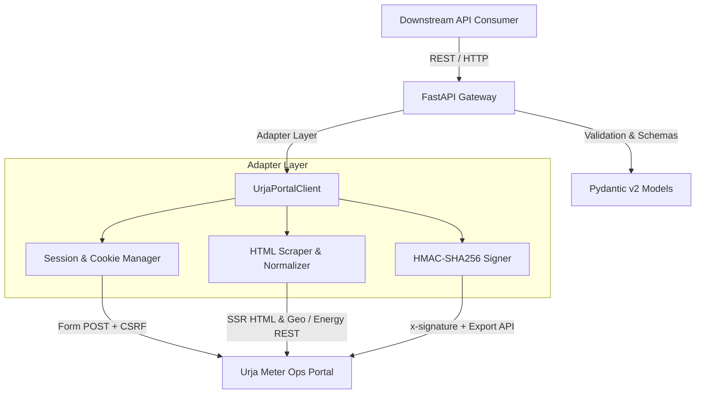

# Flock Energy: Urja Meter Ops REST API Wrapper

[](https://fastapi.tiangolo.com)
[](https://www.python.org/)
[](LICENSE)
[-brightgreen.svg)]()

> A robust, modern, and production-grade REST API proxy and data normalization service built over the legacy **Urja Meter Ops** portal (`https://urja-ops.flockenergy.tech`).

---

## 1. Project Overview

The legacy Urja Meter Ops web portal requires manual browser navigation to inspect electrical smart meters, nameplate specifications, network hierarchies, and consumption timeseries.

This service acts as an intelligent API wrapper and data normalization layer that:
1. **Automates Session Management**: Handles authentication against the SvelteKit portal, manages secure cookies (`__Secure-better-auth.session_token`), and automatically re-authenticates when sessions expire.
2. **Transforms & Cleans Legacy Data**: Converts server-rendered HTML tables and unstructured string-encoded data into clean, strongly typed Pydantic JSON schemas.
3. **Calculates Real-Time Analytics**: Derives summary statistics for consumption time-series (active energy ranges, voltage fluctuations, latest readings).
4. **Discovers Cryptographic Protocols**: Integrates dynamic HMAC-SHA256 signature generation to interact with the portal's secure export subsystem.
5. **Generates OpenAPI 3.1 Specs**: Provides interactive Swagger UI (`/docs`), ReDoc (`/redoc`), and downloadable `openapi.json`.

---

## 2. Architecture



---

## 3. Project Structure

```
flock-energy-api/
├── app/
│   ├── __init__.py          # Package initialization
│   ├── config.py            # Environment settings (Pydantic Settings)
│   ├── models.py            # Pydantic data schemas & contracts
│   ├── client.py            # Legacy portal adapter, session manager & scraper
│   └── main.py              # FastAPI application & route definitions
├── tests/
│   ├── __init__.py
│   └── test_api.py          # Pytest automated test suite (live portal verification)
├── openapi.json             # Exported OpenAPI 3.1 specification
├── PROTOCOL.md              # Deep-dive protocol reverse engineering findings
├── REFLECTION.md            # Comprehensive answers to reflection questions
├── README.md                # Main documentation, setup instructions & curl examples
├── requirements.txt         # Production dependencies
├── .env.example             # Template environment variables
└── .gitignore               # Ignored artifacts
```

---

## 4. Quick Start & Setup

### Prerequisites
- Python 3.10 or higher
- Git

### Installation

1. **Clone repository**:
   ```bash
   git clone <YOUR_GITHUB_REPO_URL>
   cd "flock energy"
   ```

2. **Create and activate virtual environment**:
   ```bash
   # Windows
   python -m venv .venv
   .venv\Scripts\activate

   # Linux / macOS
   python3 -m venv .venv
   source .venv/bin/activate
   ```

3. **Install dependencies**:
   ```bash
   pip install -r requirements.txt
   ```

4. **Configure environment**:
   ```bash
   cp .env.example .env
   ```
   *(Default values are pre-configured for the live Urja Ops portal)*.

5. **Start development server**:
   ```bash
   uvicorn app.main:app --host 0.0.0.0 --port 8000 --reload
   ```

6. **Access Interactive API Docs**:
   - **Swagger UI**: [http://localhost:8000/docs](http://localhost:8000/docs)
   - **ReDoc**: [http://localhost:8000/redoc](http://localhost:8000/redoc)
   - **OpenAPI Schema**: [http://localhost:8000/openapi.json](http://localhost:8000/openapi.json)

---

## 5. API Reference & Sample cURL Requests

### 1. Healthcheck
Check system health, connectivity to legacy portal, and authentication status:
```bash
curl -X GET "http://localhost:8000/health"
```
**Sample Response (200 OK)**:
```json
{
  "status": "healthy",
  "portal_connected": true,
  "authenticated": true,
  "version": "1.0.0"
}
```

---

### 2. Authentication Login
Explicitly establish an operator session:
```bash
curl -X POST "http://localhost:8000/api/v1/auth/login" \
     -H "Content-Type: application/json" \
     -d '{
       "email": "operator@urja.local",
       "password": "urja-ops-2026"
     }'
```
**Sample Response (200 OK)**:
```json
{
  "authenticated": true,
  "email": "operator@urja.local",
  "user_name": "Ops Desk",
  "message": "Authentication successful."
}
```

---

### 3. List & Search Meters
Retrieve paginated meters or filter by meter number / serial:
```bash
# List first page
curl -X GET "http://localhost:8000/api/v1/meters?page=1"

# Search by ID or Serial
curl -X GET "http://localhost:8000/api/v1/meters?q=J100000"
```
**Sample Response (200 OK)**:
```json
{
  "total": 403,
  "page": 1,
  "page_size": 20,
  "total_pages": 21,
  "query": "J100000",
  "data": [
    {
      "meter_id": "J100000",
      "serial_number": "SE33962",
      "make": "HPL",
      "phase_type": "single",
      "install_status": "Decommissioned",
      "dt_code": "DT-001"
    }
  ]
}
```

---

### 4. Get Meter Details
Fetch granular metadata, nameplate specifications, normalized GPS coordinates, and grid hierarchy:
```bash
curl -X GET "http://localhost:8000/api/v1/meters/J100000"
```
**Sample Response (200 OK)**:
```json
{
  "meter_id": "J100000",
  "serial_number": "SE33962",
  "make": "HPL",
  "phase_type": "single",
  "install_status": "Decommissioned",
  "install_type": "Whole Current",
  "build": "legacy",
  "dt_code": "DT-001",
  "geo": {
    "latitude": 26.938961002479868,
    "longitude": 75.83095696146852
  },
  "hierarchy": {
    "zone": { "name": "Jaipur Zone 1", "code": "Z-01" },
    "circle": { "name": "Circle 1", "code": "C-01" },
    "division": { "name": "Division 1", "code": "D-01" },
    "subdivision": { "name": "Subdivision 1", "code": "SD-01" },
    "substation": { "name": "Substation 1", "code": "SS-01" },
    "feeder": { "name": "Feeder 1", "code": "F-001" },
    "dt": { "name": "Malviya Nagar DT 1", "code": "DT-001" },
    "breadcrumbs": [
      "Jaipur Zone 1 (Z-01)",
      "Circle 1 (C-01)",
      "Division 1 (D-01)",
      "Subdivision 1 (SD-01)",
      "Substation 1 (SS-01)",
      "Feeder 1 (F-001)",
      "Malviya Nagar DT 1 (DT-001)"
    ]
  },
  "nameplate_attributes": {
    "Meter ID": "J100000",
    "Serial No": "SE33962",
    "Make": "HPL",
    "Phase Type": "single",
    "Installation Status": "Decommissioned",
    "Installation Type": "Whole Current"
  }
}
```

---

### 5. Get Meter Consumption History & Analytics
Retrieve time-series readings with aggregated summary statistics:
```bash
curl -X GET "http://localhost:8000/api/v1/meters/J100000/consumption"
```
**Sample Response (200 OK)**:
```json
{
  "meter_id": "J100000",
  "summary": {
    "total_readings": 337,
    "latest_reading": {
      "timestamp": "23/06/2026 23:30",
      "kwh": 48438.74,
      "kvah": 52313.84,
      "volt_r": 226.0
    },
    "min_kwh": 48102.15,
    "max_kwh": 48438.74,
    "min_volt_r": 218.0,
    "max_volt_r": 242.0
  },
  "readings": [
    {
      "timestamp": "23/06/2026 23:30",
      "kwh": 48438.74,
      "kvah": 52313.84,
      "volt_r": 226.0
    }
  ]
}
```

---

### 6. Get Electrical Grid Hierarchy Tree
Retrieve the full distribution tree linking Transformers, Feeders, and Meters:
```bash
curl -X GET "http://localhost:8000/api/v1/hierarchy"
```
**Sample Response (200 OK)**:
```json
{
  "total_transformers": 40,
  "transformers": [
    {
      "code": "DT-001",
      "name": "Malviya Nagar DT 1",
      "feeder_code": "F-001",
      "capacity_kva": 100.0
    }
  ],
  "tree": {
    "Jaipur Zone 1": {
      "feeders": {
        "Feeder 1": {
          "transformers": {
            "DT-001": {
              "meters": [
                {
                  "meter_id": "J100000",
                  "serial_number": "SE33962",
                  "make": "HPL",
                  "install_status": "Decommissioned"
                }
              ]
            }
          }
        }
      }
    }
  }
}
```

---

## 6. Running Automated Tests

Run the full pytest suite:
```bash
pytest -v
```
All 7 unit and integration tests validate live against `https://urja-ops.flockenergy.tech`:
- Health check
- Session authentication state
- Paginated meter search
- Text query filtering
- HTML nameplate and geo coordinate parsing
- Time-series numeric normalization & summary calculations
- Network hierarchy tree generation

---

## 7. Submission Checklist & Instructions

### A. Submitting the GitHub Link
1. Initialize the git repository (already initialized):
   ```bash
   git add .
   git commit -m "feat: complete Urja Meter Ops REST API wrapper, protocol reverse-engineering, and test suite"
   ```
2. Create a new repository on your GitHub account (e.g., `flock-energy-api`).
3. Link and push your code:
   ```bash
   git branch -M main
   git remote add origin https://github.com/<your-username>/<your-repo-name>.git
   git push -u origin main
   ```
4. Copy your repository URL for submission.

### B. Creating the Screen Recording
To record your screen demonstration:
- **Windows Built-in Recorder**: Press `Win + Alt + R` or `Win + G` (Xbox Game Bar), or use **Snipping Tool** (`Win + Shift + S` -> Video mode).
- Alternatively, use **Loom** or **OBS Studio**.

**Recommended 3-5 Minute Demo Script**:
1. **Show Server Startup**:
   - Open terminal, run: `uvicorn app.main:app --reload`.
   - Highlight the startup log showing automatic session establishment with Urja Ops portal.
2. **Interactive Swagger UI Walkthrough (`http://localhost:8000/docs`)**:
   - Open browser at `http://localhost:8000/docs`.
   - Execute `GET /health` -> demonstrate `status: healthy` and `authenticated: true`.
   - Execute `GET /api/v1/meters` -> show 403 total meters and paginated results.
   - Execute `GET /api/v1/meters?q=J100000` -> show instant query search.
   - Execute `GET /api/v1/meters/J100000` -> demonstrate normalized GPS coordinates and parsed nameplate attributes from server-rendered HTML.
   - Execute `GET /api/v1/meters/J100000/consumption` -> demonstrate string-to-float numeric normalization and computed analytics (`min_kwh`, `max_kwh`, `volt_r`).
   - Execute `GET /api/v1/hierarchy` -> demonstrate the organized grid tree.
3. **Show Test Suite Execution**:
   - Run `pytest -v` in the terminal to show all 7 tests passing green.
4. **Briefly Showcase Documentation**:
   - Highlight `PROTOCOL.md`, `README.md`, `REFLECTION.md`, and `openapi.json`.
